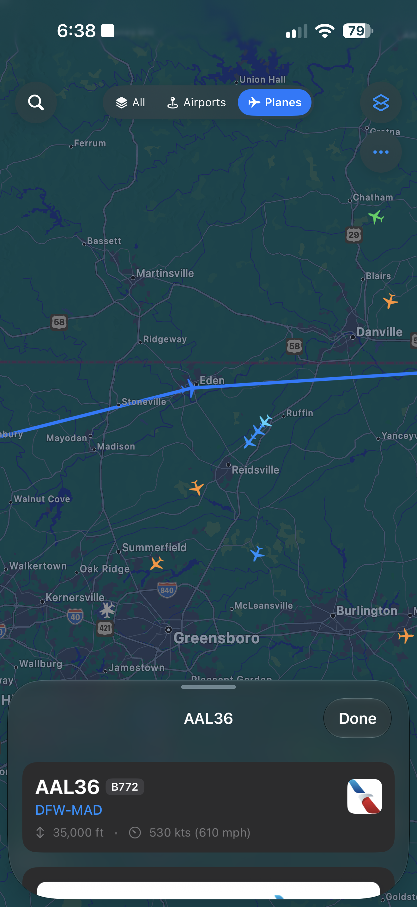
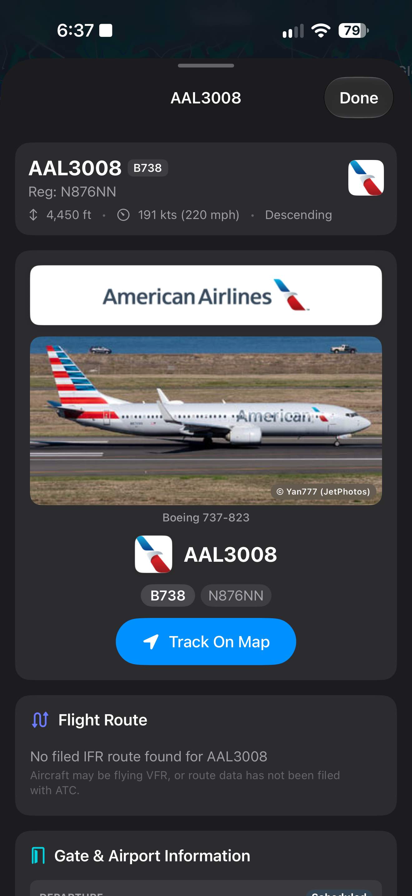
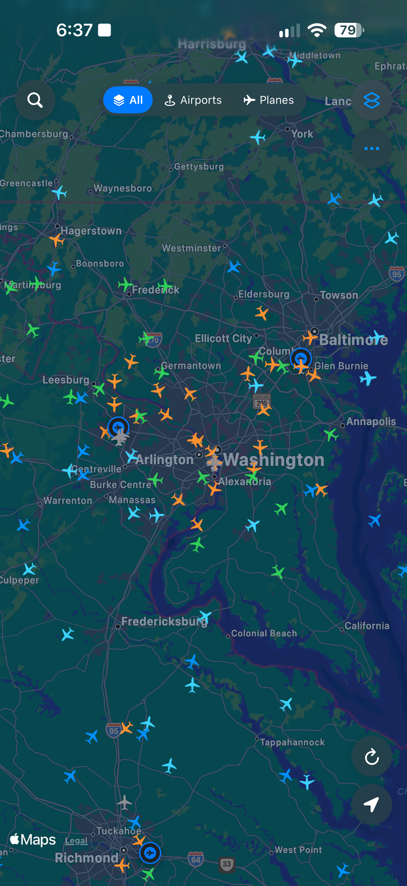

# plane-tracker
## Written in Swift for iOS 26.0+  with multi-source support, flight routes, local ADS-B transponder support and more

Lowkey built this because I got fed up with all of the other websites (FR24, PlaneFinder, etc.) bombarding with ads on mobile. This is free, open source, and can be modified to use any source required. I chose to specifically omit FR24 support from the app because in order to even use their API now, you have to pay $9 a month at the minimum. At that point, just use their app...

There is support for extra data sources such as FlightAware's AeroAPI and a backup API-Ninjas aircraft specs API in the settings page, however they are not required for the full app to work. These are just if you want the extra data sources or those specific ones. With the data sources, you can also change out each one to have specific data points come from seperate sources. 
    
<p align="center">
	
	
	
</p>

## Basic Features
- Worldwide ADS-B data tracking
- ADS-B source switching including local dump1090 hosted feeders
- Worldwide airport maps
- Flight and airplane details page
- UI customization page

### Details given by ADS-B that are listed in the app
- Airline
- Callsign
- Tail number
- Flight route (arrival/destination)
- Flight number by airline
- Telemetry (altitude, speed, heading, coordinates)
- Plane model specs (model, engines, wingspan, MTOW, ceiling, max speed, seating capacity, etc.)
- Aircraft specific extra specs (squawk, owner, ICAO 24-bit address)
- Gate and airport info (with a FlightAware API key)
- Image of the airplane
## Getting Started
### Dependencies
- Xcode 27.2 or higher
- An iOS device with iOS 26.0+ (for liquid glass support, if you want to compile without, you can use it on probably 16.1+)
- Any Apple silicon Mac running 26.6+ (or whatever can run Xcode 27.2)

### Building

This will build an IPA file you can either install with Feather, Sidestore, Flarestore, Sideloadly, basically any sideloading tool. I've tested it in the Xcode iPhone simulator and on my personal iPhone 18 Pro Max through Feather, whatever works.

Copy the files from this repository onto your own computer:

```
git clone https://github.com/slicey64/flight
```

Open the repo in Xcode and wait for any required dependencies to install. 

#### If you have your own developer certificate, these instructions do not apply to you. You can just build the IPA as normal. If you have a standard free developer account or a .p12/.mobileprovisioning file, you must follow these instructions below to build the IPA file.

- In Xcode, make sure you have the correct device set in the build target selector, most likely the "Any iOS Device (arm64)" option if you are installing on an iPhone/iPad.
- Change this to a simulator or catalyst for testing.
- On the top bar, navigate to Product > Build or click CMD + B
- This will now build (if successful) a .app file that contains everything needed for the app. 
- Go to Product > Show Build Folder in Finder > Products > debug-iphoneos and you will see a .app file and a folder. Copy the .app file into it's own new folder, and rename the folder "Payload" (This is case sensitive). Right click the folder, and click Compress "Payload".
- Rename this zip file to whatever you want the first half to be, with the file extension of .ipa
- It will now work. Good job, sideload it to your device however you'd like

### Releases

If you're lazy, you can just go to [releases](https://github.com/slicey64/flight/releases) and download from there. Most likely that's what you'll do, because building is annoying. Fair warning, I probably won't maintain this very often..
### Contributing

Pull requests are welcome, and if you want to provide any fixes, tweaks or added features by all means please let me know. This is a hobby project for me because I lowkey got fed up with ads, so if you have anything cool to add go ahead.

### Credits

* Live ADS-B map telemetry from [adsb.lol](https://adsb.lol), [adsb.fi](https://adsb.fi), [airplanes.live](https://airplanes.live), and local SDR receivers (`dump1090`/`readsb`/`tar1090`).
* Gate info, airport flight boards, historical flights, and aircraft age specs from [FlightAware AeroAPI](https://www.flightaware.com/commercial/aeroapi/) (optional user-provided API key).
* Open flight route and aircraft database fallback from [adsbdb.com](https://adsbdb.com).
* Plane photography from [jetapi.dev](https://jetapi.dev) querying JetPhotos.
* Airline banners and logos from [Jxck-S/airline-logos](https://github.com/Jxck-S/airline-logos)